# Shelf

A book search and reading-list app built with **vanilla JavaScript**, **Vite** and **Tailwind CSS v4**, powered by the [Open Library](https://openlibrary.org) API. No frameworks and no runtime dependencies: the whole app is a small state-driven render loop wired to a publish/subscribe store.

<!--
Add screenshots before publishing, then uncomment:


-->

## Contents

1. [Features](#features)
2. [Tech stack](#tech-stack)
3. [Getting started](#getting-started)
4. [Project structure](#project-structure)
5. [Architecture](#architecture)
6. [Data flow diagrams (DFD)](#data-flow-diagrams-dfd)
7. [UML diagrams](#uml-diagrams)
8. [Operational flowcharts](#operational-flowcharts)
9. [Module reference](#module-reference)
10. [Data model](#data-model)
11. [Handling incomplete API data](#handling-incomplete-api-data)
12. [Design decisions](#design-decisions)
13. [Known limitations](#known-limitations)
14. [Credits](#credits)

---

## Features

- **Debounced search** by title or author. Typing sends a single request after a short pause, not one per keystroke.
- **Four UI states** for search: loading, error (with a Retry button), empty ("no books found") and the results grid.
- **Reading list (shelf)** with add/remove on every card. A book can never be added twice.
- **Persistence:** the shelf is saved to `localStorage` and restored on startup, including a guard against corrupted stored data.
- **Live badge** in the header showing how many books are saved. Saving or removing a book updates the badge, the search cards and the shelf view at the same time, with no manual wiring.
- **Book detail view** with a larger cover, description and subject tags, fetched from the Open Library "work" endpoint. It has its own loading and error states and a Back button that returns to wherever you came from (search or shelf).
- **Stale-request protection:** an older, slower response can never overwrite a newer one (`AbortController` for search and detail, plus an id check for detail).
- **Defensive rendering:** missing covers, authors, years, subjects and descriptions never produce `undefined` or a broken image. A typographic placeholder is shown instead.
- **Friendly empty shelf** that invites the user to run a first search.

## Tech stack

| Area | Choice |
| --- | --- |
| Language | Vanilla JavaScript (ES modules) |
| Build tool | Vite |
| Styling | Tailwind CSS v4 via `@tailwindcss/vite`, utility classes only |
| Data | Open Library `search.json`, `works/{id}.json` and the covers service |
| Persistence | Browser `localStorage` |

## Getting started

```bash
npm install
npm run dev      # start the dev server
npm run build    # production build
npm run preview  # preview the production build
```

Requires Node.js. No API key or account is needed: Open Library is open and CORS-enabled.

## Project structure

```
index.html          # static shell: header (logo, search, reading-list button + badge), #view, footer
src/
  emitter.js        # generic publish/subscribe
  debounce.js       # closure-based debounce
  store.js          # shelf store: private state, immutable updates, localStorage, change events
  api.js            # the only file that talks to the network
  views.js          # pure templates: data in, HTML string out
  main.js           # state, render(), actions, one delegated click listener
  style.css         # a single line: @import "tailwindcss";
```

| File | Responsibility | Knows about |
| --- | --- | --- |
| `emitter.js` | Lets one part of the app announce an event and others react, without knowing each other | Nothing (fully generic) |
| `debounce.js` | Delays a function until the user pauses | Nothing (fully generic) |
| `store.js` | Owns the list of saved books and announces every change | `emitter.js`, `localStorage` |
| `api.js` | Fetches from Open Library and converts messy responses into clean objects | Network only |
| `views.js` | Turns data into HTML strings | Nothing but its arguments |
| `main.js` | Holds UI state, decides what to render, handles user actions | All of the above |

The rule that keeps this maintainable: **each layer has one job, and layers do not leak into each other.** No fetching in `views.js`, no HTML in `api.js`, no direct DOM writes outside `render()`.

## Architecture

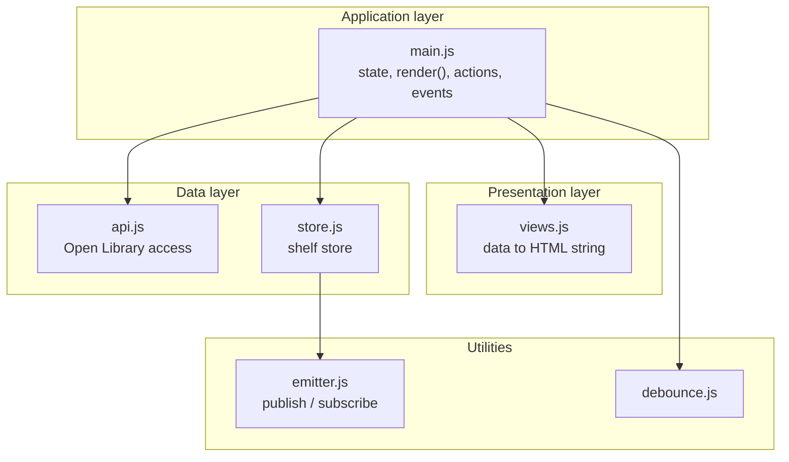

The UI follows a single loop:

> **state** is the only source of truth for the interface. **Actions** change `state` and call `render()`. **`render()`** is the only place that writes to the DOM. Changes to the shelf arrive through the store's `change` event, which also calls `render()`.

## Data flow diagrams (DFD)

### Level 0: context diagram

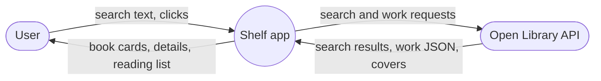

### Level 1: main processes and data stores

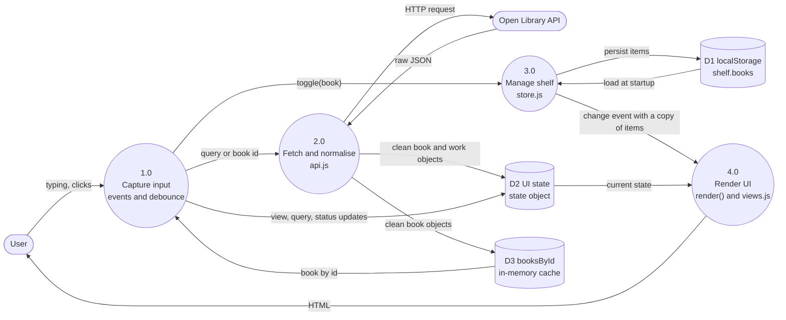

| Store | Contents | Lifetime |
| --- | --- | --- |
| D1 `localStorage` | Lean saved books under the key `shelf.books` | Persistent across reloads |
| D2 `state` | Current view, query, results, loading/error flags, detail data | Until page reload |
| D3 `booksById` | Every book returned by a search, keyed by id, so a click on a card can recover the full book object | Until page reload |

## UML diagrams

### Module / class diagram

The project has no ES classes, so modules and factory functions are modelled as classes with their public interface.

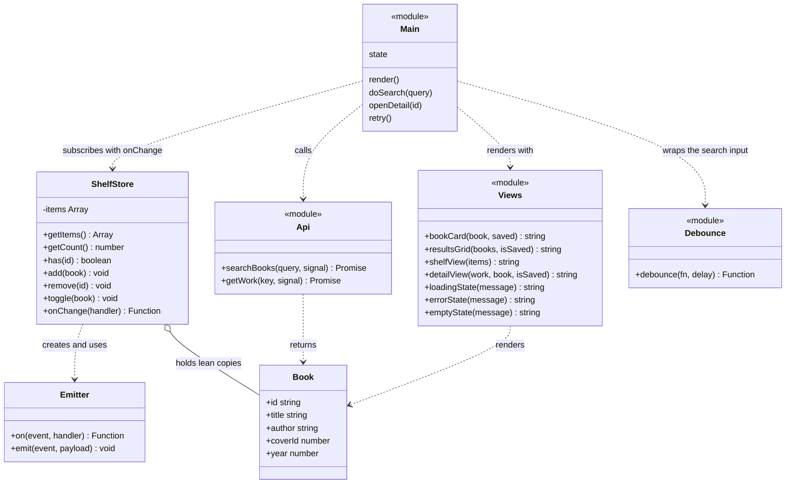

### Sequence: searching for a book

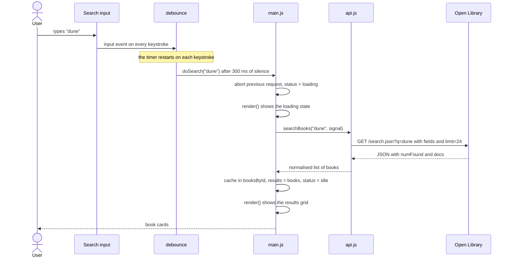

### Sequence: adding or removing a book (publish / subscribe)

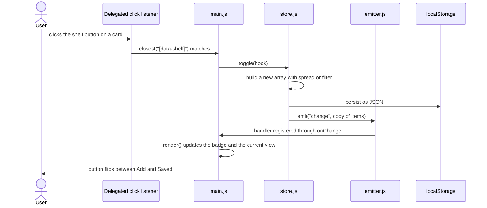

Note that `toggle` never calls `render()`. The store only announces that something changed, and `main.js` reacts because it subscribed.

### State diagram: views

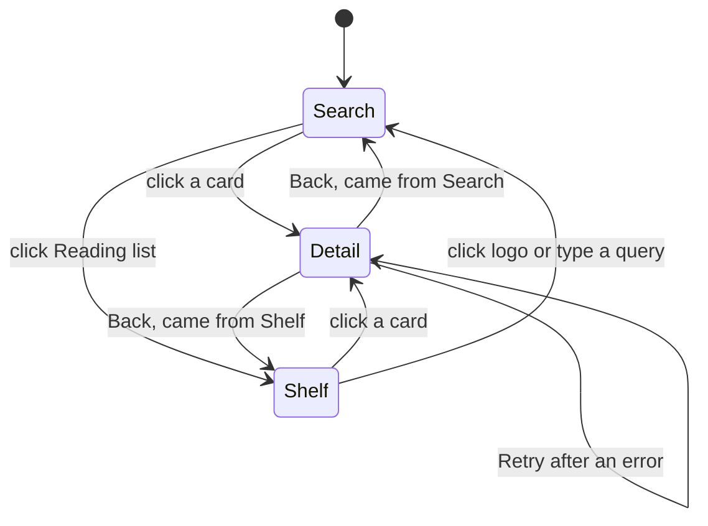

### State diagram: search status

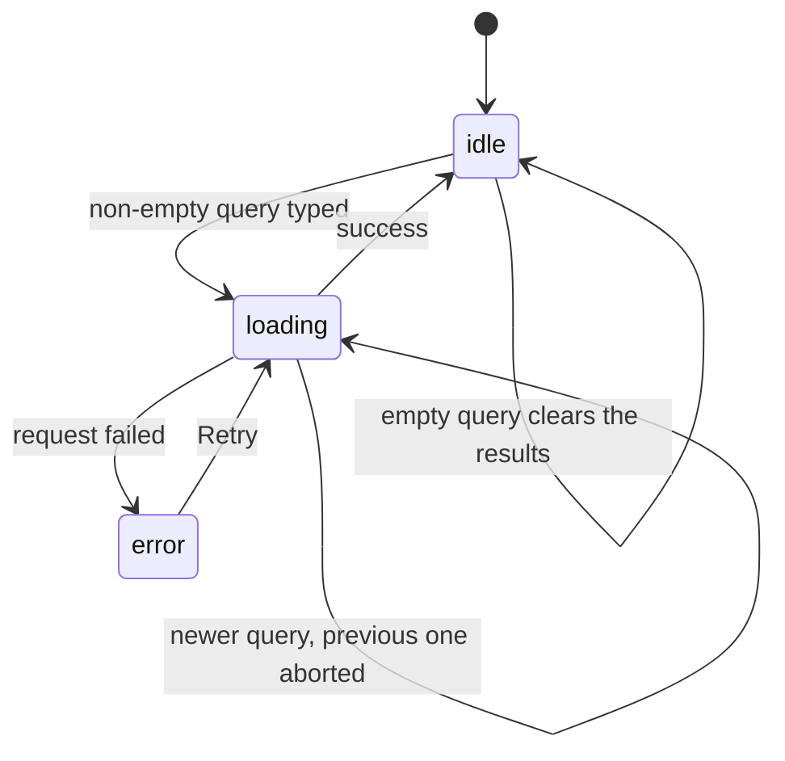

## Operational flowcharts

### `render()`

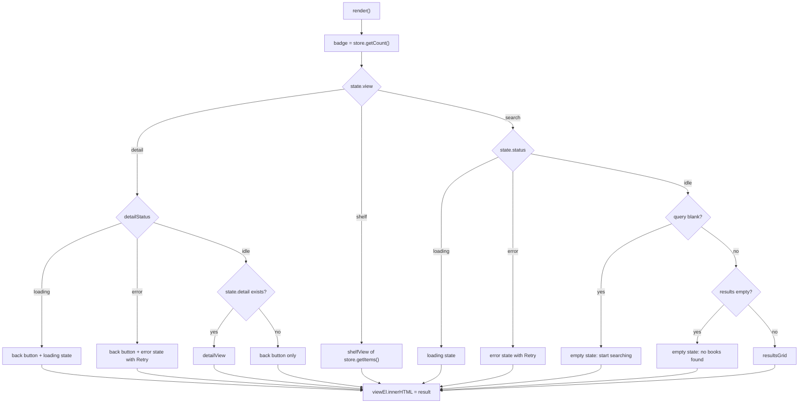

### `doSearch(query)`

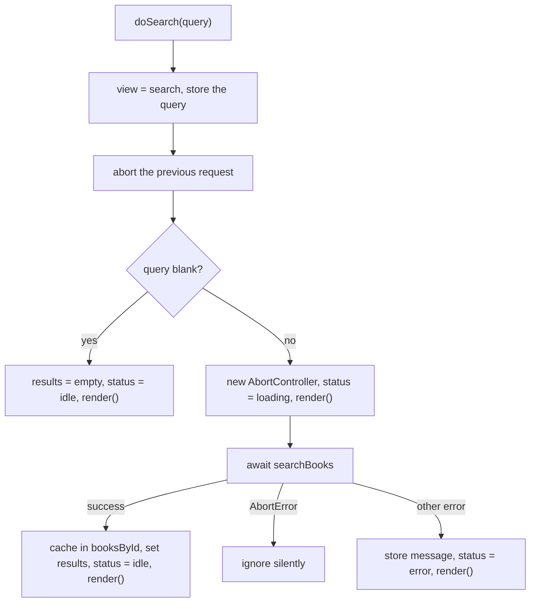

### `openDetail(id)`

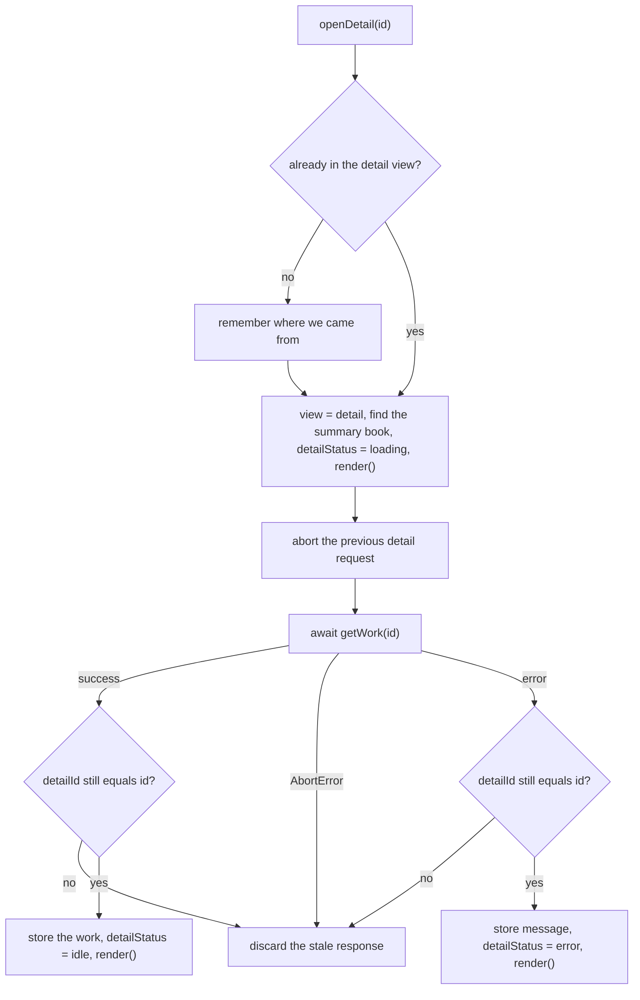

## Module reference

### `emitter.js`: publish / subscribe

`createEmitter()` returns `{ on, emit }`. Handlers live in a private object keyed by event name.

- `on(event, handler)` registers a handler and **returns an `unsubscribe` function**. That function is a closure over `event` and `handler`, so it can remove exactly that handler later and prevent leaks.
- `emit(event, payload)` calls every handler registered for the event. If nobody listens, it does nothing.

The module knows nothing about books. That is what makes it reusable.

### `debounce.js`

```js
export function debounce(fn, delay = 350) {
  let timerId;
  return (...args) => {
    clearTimeout(timerId);
    timerId = setTimeout(() => fn(...args), delay);
  };
}
```

`timerId` is shared by every call through a closure. Each call cancels the pending timer and starts a new one, so only the last call in a burst actually runs.

### `store.js`: the shelf

`createShelfStore()` returns `getItems`, `getCount`, `has`, `add`, `remove`, `toggle` and `onChange`.

- **Private state.** The array `items` lives inside the closure. Nothing outside can reach it.
- **Immutable updates.** Every change replaces the array (`[...items, lean]` or `items.filter(...)`). `push` and `splice` are never used on the shelf.
- **Single exit point.** All changes go through one `set(next)` function that (1) swaps the array, (2) persists it, (3) emits `change` with a copy. It is impossible to change the shelf without saving and notifying.
- **Defensive copies.** `getItems()` returns copies, so callers cannot mutate the store's data by accident. The `change` payload is a copy too.
- **Safe loading.** `loadInitial()` wraps `JSON.parse` in `try/catch` and checks `Array.isArray`, so corrupted storage results in an empty shelf rather than a crash.
- **Lean records.** Only `id`, `title`, `author`, `coverId` and `year` are stored, which is enough to draw a card and keeps `localStorage` small.
- **No duplicates.** `add` returns early if `has(id)` is true.

### `api.js`: network boundary

Two async functions, each checking `res.ok` (because `fetch` does not throw on HTTP 404 or 500) and throwing a readable `Error`.

- `searchBooks(query, signal)` calls `/search.json` with an `encodeURIComponent`-encoded query, an explicit `fields` list and `limit=24` to keep responses small, then maps every raw `doc` to a clean `Book`.
- `getWork(key, signal)` calls `/works/{id}.json` and returns a clean `Work`. The `description` field can be a string, an object with a `value` property, or absent. It is normalised **once, here**, into a plain string, so no view ever needs to care.

Both accept an `AbortSignal` so in-flight requests can be cancelled.

### `views.js`: pure templates

Functions that take data and return HTML strings. There is no fetching, no state and no DOM querying in this file.

- `esc()` escapes `& < > " '` for every piece of text that enters HTML, which prevents broken markup and injection.
- `cover()` renders an `` when there is a cover id, and a gradient placeholder showing the title otherwise.
- Cards and buttons carry `data-` attributes (`data-book-key`, `data-shelf`, `data-back`, `data-retry`) instead of inline `onclick`, so behaviour is attached once, centrally.
- `resultsGrid` receives an `isSaved` function rather than the store, so views never depend on the store.
- `shelfView` reuses `bookCard`, so the shelf and the search results are guaranteed to look and behave the same.

### `main.js`: state, render loop, actions, events

- **`state`** holds `view`, `from`, `query`, `results`, `status`, `error`, `detail`, `detailBook`, `detailId`, `detailStatus` and `detailError`.
- **`render()`** is the only place that writes `innerHTML`. It also refreshes the badge.
- **Actions** (`doSearch`, `openDetail`, `retry`) mutate `state` and call `render()`. They never touch the DOM directly.
- **One delegated click listener** on `document` uses `event.target.closest('[data-...]')` to handle add/remove, opening a card, Back, Retry and navigation. The check order matters: the shelf button sits inside a card, so it is tested first.
- **`store.onChange(() => render())`** keeps the badge, search cards, shelf view and detail button in sync after any shelf change.
- **Separate status for detail.** `detailStatus` is independent of the search `status`, so a pending detail request cannot leave the search view stuck on "Searching".

## Data model

**Book** (returned by `searchBooks`, stored in the shelf)

| Field | Type | Notes |
| --- | --- | --- |
| `id` | string | Open Library work key, e.g. `/works/OL27448W`. Used everywhere as the stable identifier |
| `title` | string | Falls back to `Untitled` |
| `author` | string | Authors joined with commas, falls back to `Unknown author` |
| `coverId` | number or null | `null` triggers the placeholder |
| `year` | number or null | First publish year, shown as a dash when missing |

**Work** (returned by `getWork`)

| Field | Type | Notes |
| --- | --- | --- |
| `id` | string | Same work key |
| `title` | string | |
| `description` | string | Always a string, falls back to `No description available.` |
| `subjects` | string[] | Always an array, possibly empty |
| `coverId` | number or null | First entry of `covers` |

**Storage:** the key `shelf.books` in `localStorage`, holding a JSON array of Book objects.

## Handling incomplete API data

Open Library is community-maintained, so fields are often missing. Each one is guarded at the boundary where it enters the app:

| Missing or irregular data | What would break | How it is handled |
| --- | --- | --- |
| `author_name` absent | `undefined.join()` would throw inside `map` and break the **entire** result list | Optional chaining plus fallback: `author_name?.join(", ") ?? "Unknown author"` |
| `cover_i` absent | Broken image icon | `coverId` becomes `null`, the placeholder renders |
| `first_publish_year` absent | The word `undefined` in the card | `null` in the data, a dash in the view |
| `description` is string, object or absent | Rendering `[object Object]` or `undefined` | Normalised once in `getWork` |
| `subjects` absent | Calling `.map` or `.slice` on `undefined` | Defaults to `[]`, the tags section is omitted when empty |
| `numFound` is 0 | Treating "no results" as an error | Shown as the empty state, not the error state |
| Titles containing `<`, `"` etc. | Broken layout or injected markup | Every text value passes through `esc()` |
| Corrupted `localStorage` | `JSON.parse` throws on startup | `try/catch` and `Array.isArray`, start with an empty shelf |

## Design decisions

- **Stable string ids.** Open Library work keys are strings, so ids are never converted to numbers. Using `Number()` on them would produce `NaN`.
- **Normalise once, at the boundary.** All awkward API shapes are cleaned in `api.js`, which keeps every other file simple.
- **Copy, don't mutate.** Immutable updates plus defensive copies mean the UI and the persisted data cannot drift apart.
- **Publish / subscribe over manual wiring.** The store announces changes and the UI subscribes. Adding another listener, such as a second view, would need no change to the store.
- **Separate async states.** Search and detail each have their own status, and each guards against stale responses.
- **Cancel superseded requests.** `AbortController` stops outdated searches, and the abort happens before the blank-query check so that clearing the input cannot be overwritten by a slow older response.
- **Escape plain text, not HTML.** Open Library descriptions are plain text, so they are escaped. This differs from APIs that return trusted HTML.
- **Event delegation.** One listener serves all buttons, and it keeps working after every re-render because it is attached to `document`, not to elements that get replaced.
- **Be gentle with a free public API.** Debounced input, an explicit field list and a result limit keep traffic small.

## Known limitations

- No pagination ("load more"). Each search returns the first 24 results.
- No keyboard shortcuts (for example `Enter` to open a card, `Esc` to go back).
- Reading status per book (want to read, reading, read) and shelf sorting are not implemented.
- No automated tests. Behaviour was verified manually, including offline mode, retry, books with missing fields and reload persistence.
- No offline fallback if Open Library is unreachable: the error state with Retry is shown instead.
- Descriptions from Open Library sometimes contain raw Markdown links, which are displayed as plain text.

## Credits

Book data is provided by [Open Library](https://openlibrary.org), a project of the [Internet Archive](https://archive.org). Cover images are served from `covers.openlibrary.org`.

The overall architecture (emitter, store, api, views and a state-driven `main.js`) follows the pattern from the course project *Screen Time*, re-implemented here for a new domain and API.
